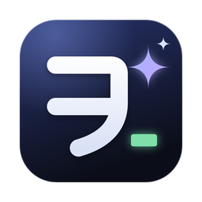
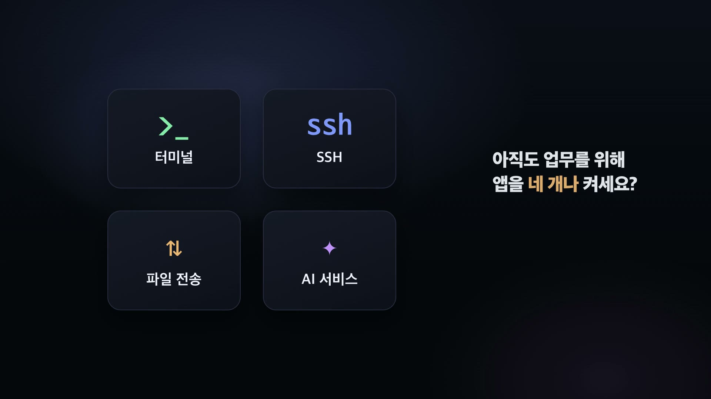
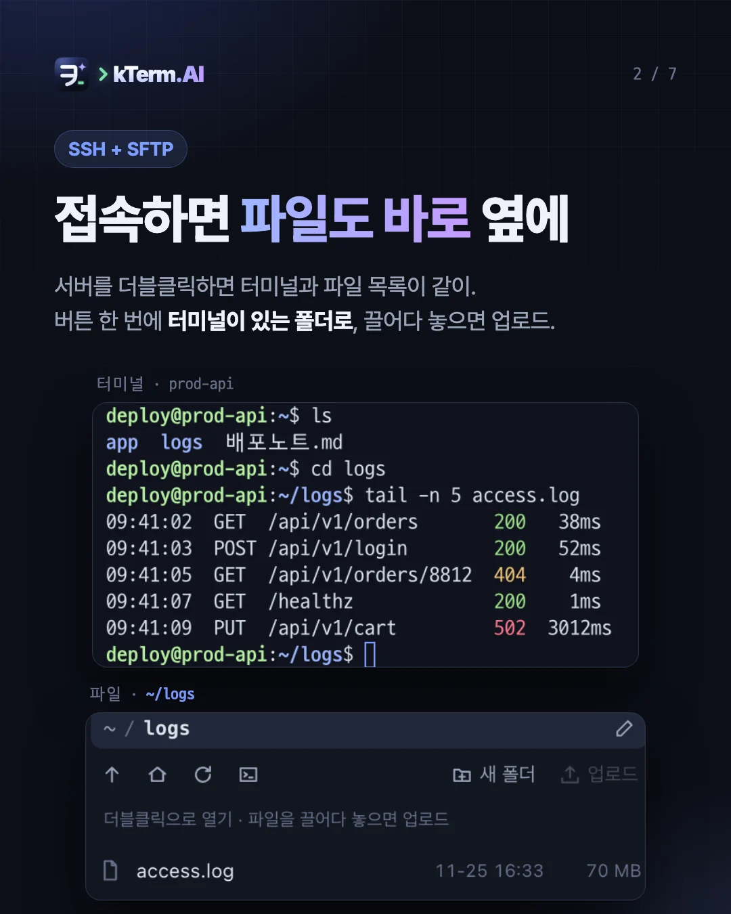
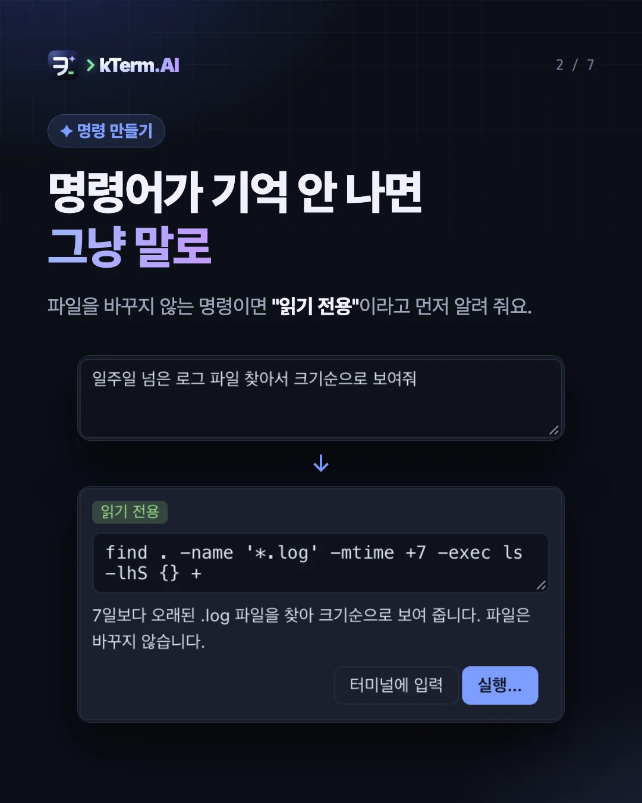
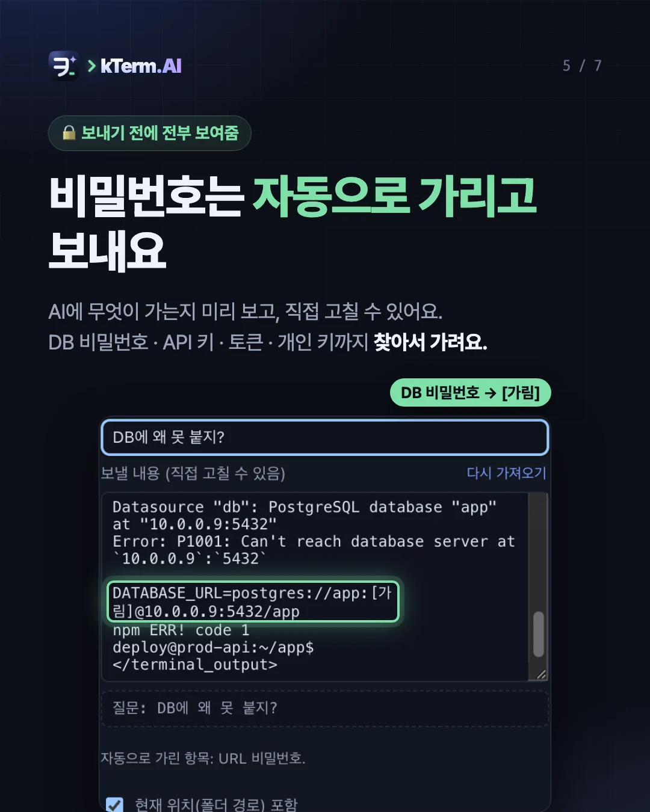
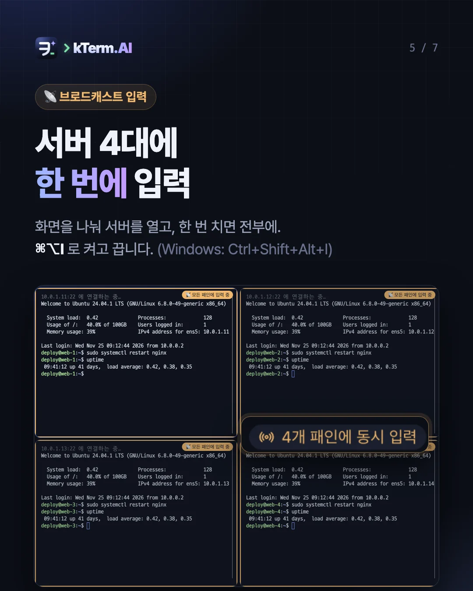
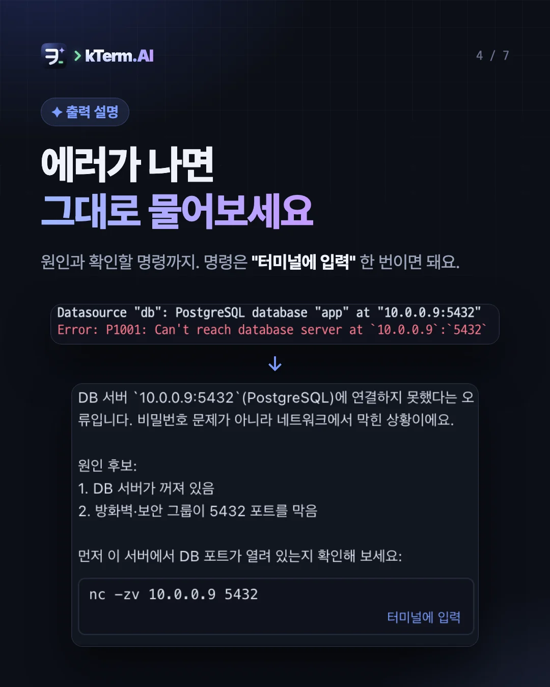
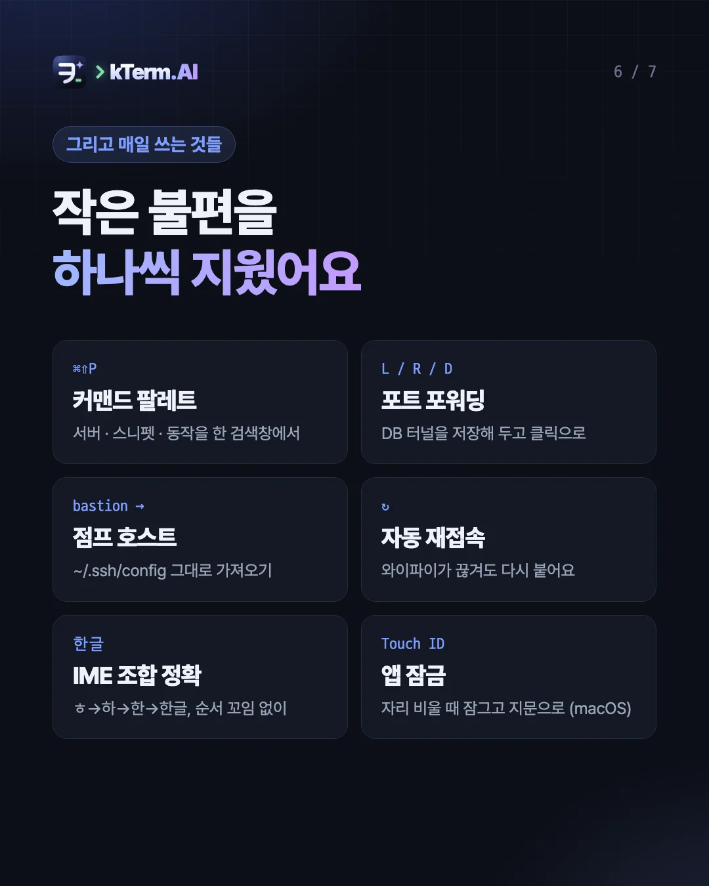

<p align="center"></p>

<h1 align="center">kTerm.AI</h1>

<p align="center"><b>터미널 · SSH · 파일 · AI를 한 화면에</b><br>쓰고 있는 Claude Code · Codex · Antigravity(Gemini) 구독을 터미널 옆에서 바로 씁니다.<br>macOS · Windows 테스트 버전</p>

<p align="center"><a href="https://01-june-0.github.io/k-term-ai-releases/"><b>소개 페이지</b></a> · <a href="https://01-june-0.github.io/k-term-ai-releases/#demo">45초 시연 영상</a> · <a href="https://github.com/01-june-0/k-term-ai-releases/releases/latest">최신 릴리스</a></p>

<p align="center"><a href="https://01-june-0.github.io/k-term-ai-releases/#demo"></a></p>

## 설치 · 업데이트

**macOS** (Apple silicon, Intel 모두) — macOS 기본 **터미널** 앱에서:

```bash
curl -fsSL https://raw.githubusercontent.com/01-june-0/k-term-ai-releases/main/install.sh | bash
```

**Windows** (64비트) — PowerShell에서:

```powershell
[Net.ServicePointManager]::SecurityProtocol = 'Tls12'; irm https://raw.githubusercontent.com/01-june-0/k-term-ai-releases/main/install.ps1 | iex
```

같은 명령을 다시 실행하면 최신 버전으로 업데이트됩니다. 설정과 저장한 호스트는 그대로 남습니다.
업데이트 전에 kTerm.AI를 먼저 종료하세요 (열린 터미널·SSH 세션은 닫힙니다). kTerm.AI 안의 터미널에서는 업데이트할 수 없습니다.

## 둘러보기

<table>
<tr>
<td></td>
<td></td>
<td></td>
</tr>
<tr>
<td></td>
<td></td>
<td></td>
</tr>
</table>

## 알아 둘 점

- 테스트 버전이라 Apple·Microsoft의 정식 서명이 없습니다.
- **macOS**: 위 설치 명령으로 설치하면 바로 열립니다. 릴리스 페이지에서 zip을 직접 받아 풀면 "확인되지 않은 개발자" 경고로 열리지 않으니 설치 명령을 써 주세요.
- **Windows**: "Windows의 PC 보호" 창이 뜨면 **추가 정보 → 실행**을 누르세요.
- macOS에서 처음 실행할 때 키체인 접근을 묻는 창이 뜰 수 있습니다. **항상 허용**을 누르면 됩니다.
- AI 기능(Claude Code · Codex · Antigravity(Gemini))은 각 CLI가 따로 설치·로그인되어 있어야 합니다. 앱의 설정 화면에 설치 방법 안내가 있습니다.

## 삭제

- **macOS**: `응용 프로그램`의 kTerm.AI를 휴지통으로 옮깁니다. 설정까지 지우려면 `~/Library/Application Support/ai.kterm.app`, `~/Library/WebKit/ai.kterm.app`, `~/Library/Caches/ai.kterm.app` 폴더도 지웁니다. 저장한 비밀번호·키는 **키체인 접근** 앱에서 `ai.kterm.app`을 검색해 지웁니다.
- **Windows**: 설정 → 앱 → kTerm.AI → 제거. 제거 화면에서 **애플리케이션 데이터 삭제하기**를 체크하면 설정도 함께 지워집니다. 저장한 비밀번호·키는 **자격 증명 관리자** → Windows 자격 증명에서 `ai.kterm.app` 항목을 지웁니다.

## 문제 알리기

이상한 동작을 발견하면 화면 캡처나 오류 메시지와 함께 배포한 사람에게 알려 주세요.
